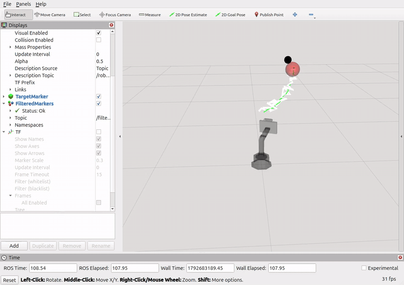

# Assignment 2 (Extra questions for CPSC-5590)

The sections below for Assignment 2 are only meant to be completed/answered by students taking CPSC-5590. Students in CPSC-4590 are welcome to try to solve the problems/tasks below and even come to office hours to discuss them. However, their answers to the questions in Parts IV and V of the Assignment 2 will not be considered during grading.

## Part IV. Addressing Delayed Observations

Part III of this assignment assumed that perception of the moving target was instantaneous. However, in many real-world applications, by the time a detection of the target reaches your filter, the target has
already moved. You can simulate this with the `observation_delay_frames` argument of the `follow_target.launch.py` file. For instance, if you run:

```bash
$ ros2 launch shutter_kf follow_target.launch.py add_noise:=true path_type:=circular observation_delay_frames:=12
```

Then, each observation on the `/target` topic is published 12 frames (0.4 seconds at 30 Hz) after it was generated by [generate_continuous_target.py](shutter_kf/scripts/generate_continuous_target.py), which simulates a sensing delay. The `header.stamp` of the observation is still the time when the observation was generated, so you can tell how old each observation is when it reaches your filter. Because of this delay, even if your filter estimated the observed position well in Part III of this assignment, its output on `/filtered_target` would now lag behind the true target, and so would the robot's motion. As shown below in RViz, the white track of observations and the red ball (the latest observation) trail the black ball that shows the true target position:



Note that the true, undelayed position of the target is available in `/true_target` so you can compare it with your filter's output (e.g., in RViz), but your code should never subscribe to this topic.

### Questions / Tasks

- **IV-1.** Copy the `kalman_filter.py` script into a new `future_kalman_filter.py` script within the `shutter_kf/scripts` folder. Then, modify the new `future_kalman_filter.py`
script so that it forecasts the position of the target into the future to make up for the delay in the observations.
The forecast should estimate where the true target is **now** (i.e., the position on `/true_target`, which your filter must
not subscribe to). 

Your new filter should output the forecasted position as a PoseStamped message through a new `/future_target` topic. Because the `follow_target.launch.py` script
still runs your original `kalman_filter.py`, also rename the node in your new script (e.g., to `future_kalman_filter_node`) and publish
its markers through a new `/future_markers` topic so that the two filters do not conflict. You may also want to change the colors of the visualization markers for your new filter so that you can distinguish them easily in RViz from the markers published by your original filter from Part III.

    To evaluate whether the robot is better tracking the target, first make your new script executable and rebuild your workspace:

    ```bash
    $ chmod +x future_kalman_filter.py
    $ cd <path-to-your-ros2-workspace>
    $ MAKEFLAGS="-j1 -l1" colcon build --symlink-install --packages-select shutter_kf --cmake-args -DCMAKE_BUILD_TYPE=Release --parallel-workers 1
    $ source install/setup.bash
    ```

    Then, run the `follow_target.launch.py` script so that the robot follows the `/future_target` topic:

    ```bash
    $ ros2 launch shutter_kf follow_target.launch.py add_noise:=true path_type:=circular observation_delay_frames:=12 follow_target_topic:=/future_target
    ```

    And, in another terminal, run your new filter:

    ```bash
    $ ros2 run shutter_kf future_kalman_filter.py --ros-args -p use_sim_time:=true
    ```

    You can then visualize in RViz how well your new filter is working and even compare it with the prior version.

    > Tip: The `header.stamp` of each observation tells you when it was captured. Compare it with the current time
    of your node to know how far into the future you need to forecast. How well the forecast works also depends on
    how noisy your filter's velocity and acceleration estimates are, so you may need to tune your filter's process noise.

    Note that the robot still lags a bit behind the target even with a perfect forecast, because MoveIt Servo takes
    some time to move the arm. Your forecast should not try to make up for that lag.

    **How to check your work:** The [test_future_filter_quality.py](shutter_kf_public_tests/test/test_future_filter_quality.py) test
    runs the launch command above together with your `future_kalman_filter.py` (and your `kalman_filter.py`), and compares
    the true position of the target with the latest position of: your forecast on `/future_target`, the raw observations
    on `/target`, a moving average of these observations, and your Part III filter on `/filtered_target`. It passes if the average error
    of your forecast is at most 0.7 times the error of the raw observations, and lower than the errors of the moving average and of
    `/filtered_target`. You can run the test as follows:

    ```bash
    $ colcon test --packages-select shutter_kf_public_tests --event-handlers console_direct+ --ctest-args -R test_future_filter_quality
    ```

    The test uses the circular trajectory by default. As in Part III, set the `PATH_TYPE` environment variable to test the horizontal
    and vertical trajectories:

    ```bash
    $ PATH_TYPE=horizontal colcon test --packages-select shutter_kf_public_tests --event-handlers console_direct+ --ctest-args -R test_future_filter_quality
    ```

    It is expected that your `future_kalman_filter.py` passes a similar test for all three motion trajectories.

- **IV-2.** The trace of a square matrix is the sum of the elements on its main diagonal:
=\sum_{i=1}^{n}M_{ii})<!--$`\mathrm{tr}(M)=\sum_{i=1}^{n}M_{ii}`$-->.
For a covariance matrix, the trace is a useful summary of uncertainty: the diagonal entries hold the variance of each
individual random variable, )<!--$`Var(X_i)`$-->, so adding them up gives the total
spread across all the variables (ignoring the correlations between them, which are in the off-diagonal entries).

    Modify your `future_kalman_filter.py` node so that it prints the trace of the position block of
    <!--$`\Sigma`$--> (i.e., the 3x3 block of the covariance that
    corresponds to the x, y, z position of the target in your state) for:
    - a) the current state, which is the belief of your filter right after it incorporates the latest observation (without forecasting), and
    - b) the forecasted state that your node publishes on `/future_target`.

    Specifically, each time your filter incorporates a new observation, print one line with the current time of your node, the trace for (a), and the trace for (b). 
    
    Then, run your node as in IV-1 with the circular trajectory, but with `observation_delay_frames:=24`. Wait at least 5 seconds (according to your node's clock) after your filter receives its first observation, and then report at least 3 of the printed lines with traces for (a) and (b) in your  report.

- **IV-3.** Based on the equations of your Kalman filter, explain in your report why the trace for (b) differs from the trace for (a) in IV-2.

- **IV-4.** For trace (b), explain why its values are almost constant across the lines that you reported in IV-2. If your values are not almost constant, explain what in your implementation or your run causes them to vary.


## Part V. Non-Parametric Filtering

In this part of the assignment, you should think about how to implement a particle filter for object tracking (Part III & IV). No code needs to be implemented, but answers must be included in your final report.

### Questions / Tasks

- **V-1.** Would a particle filter be advantageous over a Kalman Filter for tracking the red ball used throughout this assignment? Explain in your report why or why not you expect a particle filter to be advantageous.

- **V-2.** If you were to implement a particle filter for tracking your object in Part IV, can you use the same transition (motion) model as in your Kalman Filter implementation? Do you need to modify it in any way? Explain in your report.

- **V-3.** If you were to implement a particle filter for tracking your object in Part IV, how would you compute the weights for the particles?
