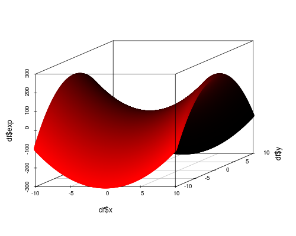
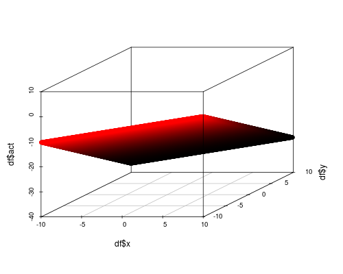
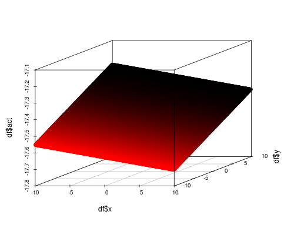
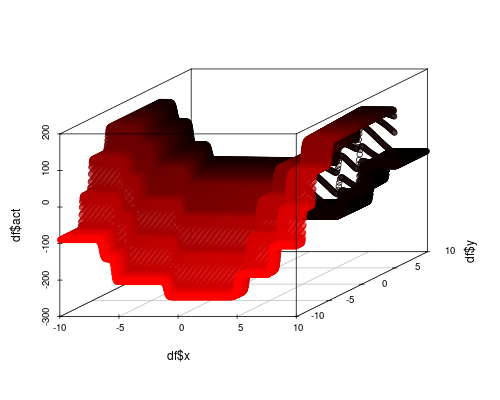
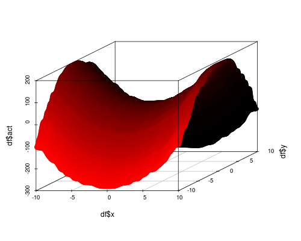

# A primer on universal function approximation 

This guide is based on the primer by *Brian Lee Yung Rowe*, Adjunct Professor at the CUNY MS Data Analytics program, on universal function approximation with deep learning (in Torch and R). Brian's primer was originally published on Data Science Central, but is not accessbile anymore. However, an archived copy can be seen [here](https://web.archive.org/web/20250426070422/https://www.datasciencecentral.com/a-primer-on-universal-function-approximation-with-deep-learning/). Sections of the primer are reproduced below as complementary background for Assignment 2; however, the explanations have been ported to PyTorch.


---

One known property of artificial neural networks (ANNs) is that they are universal function approximators. This means that any mathematical function can be represented by a neural network. Let's see how this works.

## Function Approximation

Universal function approximation may sound like a powerful spell recently discovered. In fact, function approximation has been around for centuries. Common techniques include the [Taylor series](http://mathworld.wolfram.com/TaylorSeries.html) and the [Fourier series](http://mathworld.wolfram.com/FourierSeries.html) approximations. Recall that given enough terms, a Taylor series can approximate any function to a certain level of precision about a given point, while a Fourier series can approximate any periodic function. By definition, these series are linear combinations of multiple terms. The same is true of neural networks, where output values are linear combinations of their input. The difference is that neural networks can approximate a function over a set of points.

To illustrate, consider the function $z = 2x^2 - 3y^2 + 1$. This function describes a saddle, as shown in Figure 1. This function is clearly nonlinear and cannot be accurately approximated by a plane (such as a linear regression). Can NNs do better?

<p align="center">
  <br/>
  <em>Figure 1. The saddle function 2x^2 – 3y^2 + 1.</em>
</p>

For sake of argument, let's attempt to approximate this function with a $2 \times 1$ network anyway. In its most basic form, a one layer neural network with $n$ input nodes and one output node is described by $y = Ax + b$, where $x$ is the input, $b$ is the bias and $A$ is the weight matrix. In this case, since $y$ is a scalar, $A$ is simply a vector. In [PyTorch](https://pytorch.org/), this network can be described by

```python
import torch.nn as nn

model = nn.Sequential(
    nn.Linear(2, 1),
)
```

After training, we can apply the training set to the model to see what the neural network thinks $z$ looks like. Not surprisingly it's a plane, which is far from what we want.

<p align="center">
  
</p>

Let's bring in the cavalry and add a hidden layer to create a $2 \times 10 \times 1$ network. Surely with a hidden layer (and more parameters) the network can do a better job of approximating $z$. In PyTorch, we say

```python
model = nn.Sequential(
    nn.Linear(2, 10),
    nn.Linear(10, 1),
)
```

Alas, it isn't so. The result is still a plane, albeit slightly rotated.

<p align="center">
  
</p>

Before you lose faith in artificial neural networks, let's understand what's happening. In the single layer network with one output node, we said $A$ was a vector. In this case $A$ is a proper matrix since the output is a hidden layer with 10 nodes. So $y$ is a vector of size 10. In the output layer we have a new weight matrix and bias term applied to $y$. Mathematically, the second layer is simply applying a second linear transformation. In others words, we still get a plane, since all terms are linear! To move beyond linear functions, we need to inject nonlinearity in the model.

## Activation Functions

Linearity is an exceptionally useful property, but in terms of functions, it's not particularly interesting. The nonlinear world is far more mysterious and exciting, and so it is with neural networks. Nonlinearity is injected into neural networks through the use of an [activation (aka transfer) function](https://pytorch.org/docs/stable/nn.html#non-linear-activations-weighted-sum-nonlinearity). This function $g$ is applied to the linear component: $y = g(Ax + b)$. The choice for $g$ ranges from the sigmoid to tanh to the rectified linear unit (ReLU), which is the most common choice for hidden layers in practice. Note that PyTorch layers like `nn.Linear` do not apply any activation by default; it must be added explicitly.

```python
model = nn.Sequential(
    nn.Linear(2, 10),
    nn.Tanh(),
    nn.Linear(10, 1),
)
```

The result of this model is starting to look like the target function. So we're on the right track.

<p align="center">
  
</p>

However, the result is rather blocky. This suggests that there are not enough parameters to properly capture the nonlinearity. By increasing the hidden layer to 40 nodes, we can smooth this out further.

<p align="center">
  
</p>


## Conclusion

Function approximation is a powerful capability of neural networks. In theory any function can be approximated, but constructing such a network is not so trivial. One of the key lessons with neural networks is that you cannot blindly create networks and expect them to yield something useful. Not only does it take patience, but it takes an understanding and appreciation of the theory to lead you down the correct path.


