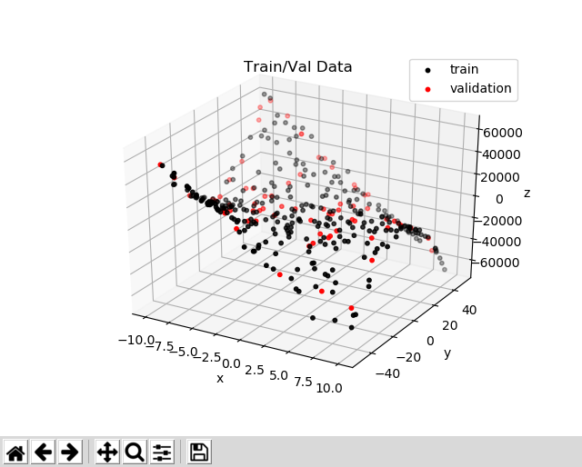
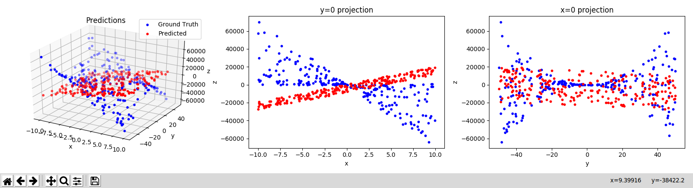
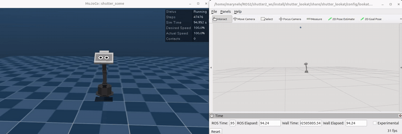
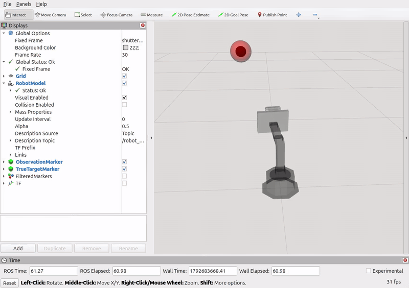
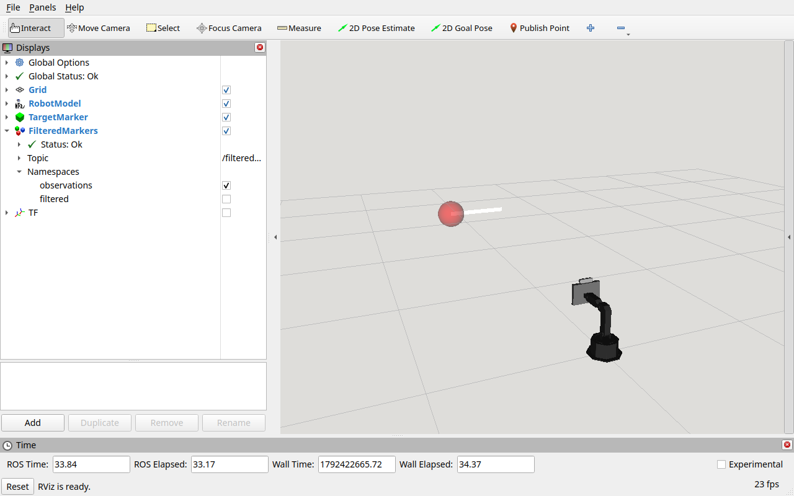
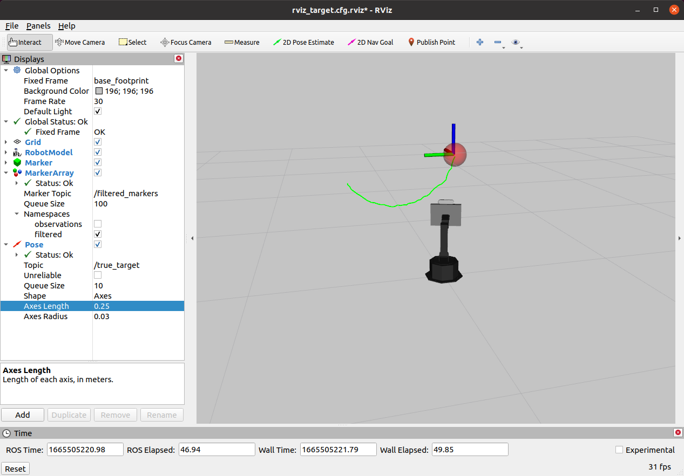

# Assignment 2

This is the second assignment for Yale's CPSC-4590/5590 Building Interactive Machines course.

## Table of Contents

* [Introduction](#introduction)
    * [System Requirements](#system-requirements)
    * [Background Knowledge](#background-knowledge)
    * [Preliminaries](#preliminaries)
    * [Deliverables](#deliverables)
    * [Evaluation](#evaluation)
* [Setup](#setup)
* [Part I. Approximating a Non-Linear Function](#part-i-approximating-a-non-linear-function)
* [Part II. Imitation Learning (2 extra points)](#part-ii-imitation-learning-2-potential-extra-points)
* [Part III. Real-Time Filtering](#part-iii-real-time-filtering)
* [Parts IV and V](#parts-iv-and-v)


## Introduction 
This assignment will provide you practical experience with deep learning. In particular, you'll become familiar with [PyTorch API](https://docs.pytorch.org/docs/2.14/pytorch-api.html).


#### System Requirements
This assignment should be completed using Python 3.12 in Ubuntu 24.04. For training neural networks, we recommend that you use cloud services if your don't have access to a local GPU. For Parts II and III of the assignment, you should have access to a computer with `ROS 2 Jazzy` and your ROS 2 workspace set up as explained in [SETUP0..md](../SETUP0_ROSWorkspace.md).

You should also have `git` and `pip3` installed in the machine that you are using to work on your assignment.
You will use git to save your work to your [Github](http://www.github.com) repository. The pip3 tool will be used to install
Python dependencies, and can be installed in Ubuntu 24.04 with `sudo apt install python3-pip`--this should already be installed in the Zoo and the bim laptops.

#### Background Knowledge

This assignment assumes that you have already completed the prior assignments and, thus, you have experience with Linux shells 
(e.g., [bash](https://www.gnu.org/software/bash/)), and [git](https://git-scm.com/). You are also expected to be familiar with the [numpy Python library](http://www.numpy.org/) for linear algebra. 
If you are not, please check [this tutorial](https://docs.scipy.org/doc/numpy/user/quickstart.html) before starting the assignment.

#### Preliminaries
You will be training supervised learning models, especially Neural Networks, for this assignment. 
It is possible to complete the training of models using your local CPU, but it might be faster at times to train on the cloud and
using hardware acceleration (e.g., a dedicated GPU).

> Whether or not you use the cloud to train your neural networks, the deliverables are the same.
You should submit code in your private Github repository. You should also submit a report to Gradescope and provide model parameter files through Google Drive.

#### Deliverables

- **Report:** You are expected to answer questions in Gradescope at the end of each part of the assignment. This online report should also have the specific commit SHA of the version of the code that you submit for the assignment. 

- **Model weights and input normalization parameters:** You should upload trained models and parameters to Google Drive and share them with anybody who has access to the links.

- **Code:** Finally, you are expected to push code for this assignment to your 
[Github](http://www.github.com) repository and submit it to Gradescope.

#### Evaluation

You assignment will be evaluated based on the content of your report and your code.

- Report (52 pts for CPSC-4590 / 72 pts for CPSC-5590)
    * Part I (32 pts): I-1 (8 pts) + I-3 (8 pts) + I-4 (10 pts) + I-5 (6 pts)
    * Part III (20 pts): III-1 (5 pts) + III-2 (5 pts) + III-3 (5 pts) + III-4 (5 pts)
    * Part V (20 pts for CPSC-5590 only): V-1 (7 pts) + V-2 (5 pts) + V-3 (8 pts)
- Code (128 pts for CPSC-4590 / 148 pts for CPSC-5590)
    * Part I (20 pts): I-1 (4 pts) + I-2 (6 pts) + I-3 (10 pts)
    * Part II (54 pts): II-1 (34 pts) + II-2 (20 pts)
    * Part III (54 pts): III-5 (8 pts) + III-6 (8 pts) + III-7 (6 pts) + III-8 (6 pts) + III-9 (4 pts) + III-10 (6 pts) + III-11 (16 pts) 
    * Part IV (20 pts for CPSC-5590 only): IV-1 (20 pts)

Students taking CPSC-4590 will be evaluated over 180 pts. Those taking CPSC-5590, will be evaluated over 220 pts.

**Note on Part II of the assignment:** Part II provides extra credit for the students that obtain best performance in this part of the assignment. The extra credit (1 pts) will be counted for the final course grade 
(beyond whatever points students get for this assignment). 

## Setup
Before you start implementing or answering questions for this assignment, please update your repository to pull the latest changes from the assignments repository, install Python dependencies, and update the `shutter-ros2` repository. 

The `install_python_deps.sh` script installs PyTorch 2.14.1 from PyPI. That build runs on the CPU, and on NVIDIA GPUs from the Turing generation (RTX 20xx) onward. If your machine has an older Pascal GPU like the GTX 1080/1070, edit the script to use the commented-out CUDA 12.6 install command instead.

```bash
# create a Python virtual environment in your workspace (only needed once).
# --system-site-packages keeps the ROS 2 Python packages visible inside the environment.
$ cd <path-to-your-ros2-workspace>
$ python3 -m venv --system-site-packages .venv

# activate your Python virtual environment
$ source .venv/bin/activate

# update your repository with the latest version of the assignment
$ cd <path-to-your-repository-in-your-workspace>
$ git pull upstream master

# install Assignment-2 Python dependencies in your virtual environment
$ cd assignment-2
$ ./install_python_deps.sh

# update the shutter-ros2 repository (bim branch)
$ cd <path-to-your-ros2-workspace>/src/shutter-ros2
$ git switch bim 
$ git pull

# finally, build your ROS 2 workspace 
$ cd <path-to-your-ros2-workspace>
$ MAKEFLAGS="-j1 -l1" colcon build --symlink-install --packages-skip moveit_ros_tests moveit_runtime --cmake-args -DCMAKE_BUILD_TYPE=Release --parallel-workers 1
```

> Tip: Activate your Python virtual environment (`source <path-to-your-ros2-workspace>/.venv/bin/activate`) in every terminal where you
train your models or run ROS nodes that use PyTorch (e.g., Part II's `run_policy.py`).

You can verify your PyTorch installation in your virtual environment as follows:

```bash
$ python3 -c "import torch; print(torch.__version__)"
(...)
2.14.1+cu130
```

The suffix after the `+` sign tells you which build you installed (e.g., `cu130` or `cu126` for CUDA 13.0 or 12.6, or `cpu`).

**NOTE:** If your machine has a GPU with NVIDIA driver, then you can take advantage of hardware acceleration. You can test that your GPU is visible in PyTorch by running the following commands on a Python shell:

```python
>> import torch
>> torch.cuda.is_available()
```

> Troubleshooting: If the above command fails, or RViz or the MuJoCo window fail to open with GLX or OpenGL errors after a system update, the NVIDIA kernel
module and the NVIDIA libraries are probably out of sync. You can check this with the `nvidia-smi` command. If it fails in a Zoo machine, please contact `cszoo.support@yale.edu`; if it fails in a bim laptop, reach out to the course staff.

## Part I. Approximating a Non-Linear Function

Read the [Primer on Universal Function Approximation](FunctionApproximationPrimer.md) that is included in this assignment.

Once you've read the primer, you should complete the tasks below to approximate the 
[monkey saddle surface](https://en.wikipedia.org/wiki/Monkey_saddle) defined by the equation .
<!-- $`z = x^3 - 3xy^2`$ --> 
Your code should leverage [PyTorch API](https://docs.pytorch.org/docs/stable/index.html).

To get you started, this assignment provides two files within the 
`assignment-2/function_approximation` directory:

- *train_and_test_saddle_function.py:* main file that you will complete in this part of the assignment.
- *saddle_function_utils:* code to generate data and help you visualize results.

If you run the `train_and_test_saddle_function.py` script (which is incomplete at this point)
with the `visualize_training_data` option, you should be able to visualize the data that the
script generates for you and example predictions with a linear neural network model implemented with 
[PyTorch API](https://docs.pytorch.org/docs/stable/index.html):

```bash
$ cd assignment-2/function_approximation
$ ./train_and_test_saddle_function.py --visualize_training_data
```

When you run the script, a [matplotlib](https://matplotlib.org/) plot of the data should appear, 
as in the figure below:



And, once the linear model is trained for a number of epochs with the 
[Adam optimizer](https://docs.pytorch.org/docs/stable/generated/torch.optim.Adam.html), the script would show a figure like the one below:



To see all the options that the train script already provides, run it as:

```bash
$ ./train_and_test_saddle_function.py --help
usage: train_and_test_saddle_function.py [-h] [--n N]
                                         [--batch_size BATCH_SIZE]
                                         [--epochs EPOCHS] [--lr LR]
                                         [--visualize_training_data]
                                         [--build_fn BUILD_FN]

optional arguments:
  -h, --help            show this help message and exit
  --n N                 total number of examples (including training, testing,
                        and validation)
  --batch_size BATCH_SIZE
                        batch size used for training
  --epochs EPOCHS       number of epochs for training
  --lr LR               learning rate for training
  --visualize_training_data
                        visualize training data
  --build_fn BUILD_FN   model to train (e.g., 'linear')
```

The optional parameters `lr`, `epochs`, and `batch_size` correspond to the learning rate,
number of epochs, and bath size that are used at training time.

Read the code in the training script to familiarize yourself with its functionality. 

### Questions/Tasks

- **I-1.** Add logging and checkpointing functionality to the `train_model()` method of the `train_and_test_saddle_function.py` script:

    
    ```python
    # Setup logging
    logs_dir = 'logs/log_{}'.format(datetime.datetime.now().strftime("%m-%d-%Y-%H-%M"))
    os.makedirs(logs_dir, exist_ok=True)
    writer = SummaryWriter(log_dir=logs_dir)

    # Add model graph to TensorBoard
    # Create a dummy input with the same shape as training data
    dummy_input = torch.as_tensor(norm_train_input[:1], dtype=torch.float32).to(device)  # Use first sample as dummy input; add_graph below only traces the model's operations
    writer.add_graph(model, dummy_input)

    best_val_loss = float('inf')
    best_model_path = os.path.join(logs_dir, 'best_monkey_weights.pth')

    # Training loop
    for epoch in range(epochs):
        ...
        # Log to tensorboard
        writer.add_scalar('Loss/Train', avg_train_loss, epoch)
        writer.add_scalar('Loss/Val', avg_val_loss, epoch)
        writer.add_scalar('MAE/Train', avg_train_mae, epoch)
        writer.add_scalar('MAE/Val', avg_val_mae, epoch)
        
        # Save best model
        if avg_val_loss < best_val_loss:
            best_val_loss = avg_val_loss
            torch.save(model.state_dict(), best_model_path)

    # After the training loop, close the writer so that all logs are written to disk
    writer.close()

    # Load best model
    model.load_state_dict(torch.load(best_model_path, weights_only=True))
    ```

    The logging and checkpointing functionality performs the following operations during the training loop:
    
    - **SummaryWriter:** The [PyTorch TensorBoard](https://pytorch.org/docs/stable/tensorboard.html) 
    writer logs training metrics to a given directory for visualization.
    - **Model Checkpointing:** The code saves the model state dict after every epoch if the
    validation loss is smaller than the prior best validation loss. The model is saved using PyTorch's
    `torch.save()` function with the `.pth` extension. After training, the best model is loaded back so that
    it is the one used for testing.<br/><br/>
    
    Run the `train_and_test_saddle_function.py` script again to check that it is indeed saving model weights to a logs folder.
    Also, check that you can visualize your training losses in TensorBoard by running it from another shell:

    ```bash
    $ tensorboard --logdir <path_to_logs>
    ```

    Then, go to the URL that the script provides (e.g., http://localhost:6006) in your favorite
    browser. The `SCALARS` tab of the TensorBoard interface should then show various training curves
    (e.g., Loss/Train, Loss/Val, MAE/Train, MAE/Val for the loss and mean absolute error after every epoch in the training and validation sets). The `GRAPHS` tab of the TensorBoard interface should show a 
    [computation graph](https://www.tensorflow.org/tensorboard/graphs) for your simple neural network model.
    
    Double-click all nodes in the graph to expand them so that you can visualize all operations within your network, and then make a screenshot of your computation graph and include it in your online report.
    
    > NOTE: In general, we recommend that you use TensorBoard to check your models' computation
    graphs and training/validation performance for all of the other tasks in this assignment. 
    This 30min [TensorBoard tutorial](https://www.youtube.com/watch?v=eBbEDRsCmv4) from 2017
    provides good examples on how the interface can help you debug many issues! Since that date, many kinds of visualization types have been added to TensorBoard--check them out [here](https://pytorch.org/docs/stable/tensorboard.html#torch.utils.tensorboard.writer.SummaryWriter).
    
- **I-2.** Modify the `train_and_test_saddle_function.py` script so that you can load a `pre-trained model` 
and train its weights further (e.g., to resume training or for fine-tuning on a new task).

    a. Add a "load_model" argument to the argument parser at the end of the script:
        
    ```python
    parser = argparse.ArgumentParser()
    ... # other arguments
    parser.add_argument("--load_model", help="path to the model",
                        type=str, default="")
    ```
        
    b. Add code after the `build_fn` variable is set at the end of the script to
    replace the value of `build_fn` with [PyTorch's model loading functionality](https://pytorch.org/docs/stable/generated/torch.load.html):
    
    ```python
    ... # Set ArgumentParser arguments()
    
    # define the model function that we will use to assemble the Neural Network
    if args.build_fn == "linear":
    ...
        
    # ---- lines to be added ----
    # load model (and thus, ignore prior build function)
    if len(args.load_model) > 0:
        # Store the original build_fn before overriding it
        original_build_fn = build_fn

        def load_pytorch_model(num_inputs):
            # Use the build_fn parameter to determine model type
            model = original_build_fn(num_inputs)
            # Load state dict
            device = torch.device('cuda' if torch.cuda.is_available() else 'cpu')
            model.load_state_dict(torch.load(args.load_model, map_location=device, weights_only=True))
            return model

        build_fn = load_pytorch_model
    # ---- end of lines to be added ----
        
    # run the main function
    main(args.n, args.epochs, args.lr, args.visualize_training_data, build_fn=build_fn, batch_size=args.batch_size)
    sys.exit(0)
    ```
        
    > Note that the PyTorch model loading uses `torch.load()` to load the state dictionary, which contains
    the model's weights and biases. The model architecture is first created using the build_fn, then the pre-trained weights are loaded using `model.load_state_dict()`. 
    With `weights_only=True` (the default since PyTorch 2.6), `torch.load()` only accepts tensors and basic Python types,
    so it can load a state dictionary but not an arbitrary pickled Python object.
        
    c. Test your code. Your script should now be able to load a model from a file and continue training
    its weights thereafter:
    
    ```bash
    $ ./train_and_test_saddle_function.py --load_model <path_to_model_pth_file> [--lr 1e-2] [--epochs 500] [--batch_size 16]
    ```
    
    The model that you trained before for task I-1 should be stored as `best_monkey_weights.pth`
    within the folder corresponding to your training session in `assignment-2/function_approximation/logs`.
    You can pass this model as argument to your `train_and_test_saddle_function.py` to test the new functionality that you just implemented.
    
- **I-3.** Complete the function called `build_nonlinear_model()` in the `train_and_test_saddle_function.py` 
script. This function should have as argument the number of input features for the data and should
return a [PyTorch model](https://pytorch.org/docs/stable/generated/torch.nn.Module.html), similar to the `build_linear_model()` function that you implemented before. The difference between these functions, though, is that `build_nonlinear_model()` should implement a more complex neural network capable of approximating the monkey saddle surface with an **average L2 error of 150 or less on the test set**. Note that this error is printed by the `train_and_test_saddle_function.py` script when it finishes running.

   The `build_nonlinear_model()` function looks as follows in the `train_and_test_saddle_function.py` script:

    ```python
    def build_nonlinear_model(num_inputs):
    """
    Build nonlinear NN model with PyTorch
    :param num_inputs: number of input features for the model
    :return: PyTorch model
    """
    ... # complete
    ```
    
    Once you've implemented the function, edit the last lines of the `train_and_test_saddle_function.py` 
    script to be able to change the model that is trained through the command line:
    
    ```python
    # define the model function that we will use to assemble the Neural Network
    if args.build_fn == "linear":
        build_fn = build_linear_model # function that builds linear model
    elif args.build_fn == "nonlinear":
        build_fn = build_nonlinear_model # function that builds non-linear model
    else:
        print("Invalid build function name {}".format(args.build_fn))
        sys.exit(1)
    ```
    
    You should then be able to train and test your model as:
    ```bash
    $ ./train_and_test_saddle_function.py --build_fn nonlinear [--lr 1e-1] [--epochs 10] [--batch_size 16]
    ```
    
    Change your nonlinear model, the learning rate, and number of epochs that you are training for
    until you achieve an average test error of 150 or less. Afterwards, take a new screenshot of the plot
    that you get after training. This plot should be similar to [docs/fit-linear.png](docs/fit-linear.png)
    but show the result for your new nonlinear model. In summary, include in your report:
     
    - The screenshot of the plot with test results after training;
    - what average L2 error did you get on the test set this time;
    - a description of the neural network model that you used to approximate the monkey saddle surface; and
    - whatever parameters you used for training it (e.g., batch size, learning rate, and number of epochs).<br/><br/>
    
- **I-4.** Train your nonlinear neural network such that it `overfits` on the training data. 

    After training, include a picture
    in your report of the plots from TensorBoard corresponding to the `mean absolute error` (mae) on the training and validation
    sets. Explain how you concluded that your model overfit in the report.
    
- **I-5.** What happens with the loss per epoch on the training set if you train with a batch size of 1?
Explain why does the loss per epoch graph look different than with a bigger batch size (e.g., than with a batch size of 100).


## Part II. Imitation Learning (1 potential extra point)

In this part of the assignment, you will gain practical experience with Behavioral Cloning. That is, you will use
supervised learning to estimate a motion policy for Shutter.

Your expert -- which you aim to learn to imitate -- will be the `expert_opt.py` node within the 
`shutter_behavior_cloning/scripts` directory. This expert uses optimization to align the face of the robot towards a target
by moving the robot's first and third joint. In practice, this type of behavior could be 
useful for the robot to convey attention towards a moving person or object in a real scenario.

> **How Shutter moves in this assignment:** The expert, your policy (Part II) and the target-following launch file
(Part III) all command the robot's joints through Shutter's servoing package, `shutter_servo`
(in `<path-to-your-ros2-workspace>/src/shutter-ros2/shutter_servo`), which is built on Shutter's own version of
[MoveIt Servo](https://moveit.picknik.ai/main/doc/examples/realtime_servo/realtime_servo_tutorial.html).
Each node creates a `ServoJointClient` (see [servo_joint_client.py](shutter_behavior_cloning/scripts/servo_joint_client.py))
and calls its `send_joint_goal([joint_1, joint_2, joint_3, joint_4])` method, which publishes the goal on the `/servo/joint_command` topic.
The `shutter_servo` node turns each goal into joint velocity commands for MoveIt Servo's `servo_node`, which moves the arm smoothly
towards the latest goal through the `joint_group_controller`, keeping the joints within their limits and stopping before the robot collides with itself.
The launch files in this assignment start `shutter_servo` for you once the simulation's controllers are up, and `shutter_servo` activates
the `joint_group_controller` on its own, so you don't need to switch controllers yourself.

To make it easy for you to run the expert and see it in action, this assignment provides you the `collect_data.launch.py` 
file. For example, if you run it as:

```bash
$ ros2 launch shutter_behavior_cloning collect_data.launch.py
```

Then, you should see the robot in RViz following the blue targets as below:


> The launch file brings up the MuJoCo simulation, RViz, MoveIt Servo, a node that publishes a new random target
every 4 seconds, and the expert. Add `headless:=true` to hide the MuJoCo window, or `rviz:=false` to skip RViz.

The above launch file can also be used to generate data for behavioral cloning:

```bash
$ ros2 launch shutter_behavior_cloning collect_data.launch.py save_state_actions:=True
```

As the launch script is running, you can check that example `state`-`action` pairs are being written
to `~/ros2_ws/install/shutter_behavior_cloning/share/shutter_behavior_cloning/data/state_action.txt`. 
New data is appended to the end of this file every time that you run the launch file. You can also pass
`output_file:=<path>` to write the data somewhere else. For example, you can check the data with:

```
$ tail -f state_action.txt
# data from 19/10/2026 10:59:38
shutter_base_footprint	3.4434	2.4219	2.3938	-0.0000	-0.0108	0.6055	0.4636
shutter_base_footprint	2.0700	-2.7549	2.3742	0.6055	0.4589	-0.9356	0.5392
shutter_base_footprint	2.0129	-2.5626	0.2120	-0.9356	0.5348	-0.9147	-0.0223
shutter_base_footprint	1.0176	-0.8722	2.0430	-0.9147	-0.0277	-0.7325	0.8717
(...)
```

The `state_action.txt` file contains comment lines that start with "#". Non-comment lines have 8 fields:
1. frame_id for the target's position
2. the target's x coordinate
3. the target's y coordinate
4. the target's z coordinate
5. the robot's current joint_1 
6. the robot's current joint_3
7. the next joint_1 that the robot should have to point towards the target
8. the next joint_3 that the robot should have to point towards the target

Thus, the state representation for this imitation learning problem is 5-dimensional. 
It corresponds to the target's position (X,Y,Z) and the current position for the robot's joint_1 and joint_3. 
The output action is 2-dimensional. It corresponds to the new position for the robot's joints.

### Questions / Tasks

- **II-1.** Generate data for behavioral cloning as explained in the prior section, and implement a script to learn
an imitation policy from this data using the PyTorch API (version 2.14.1 as in [install_python_deps.sh](install_python_deps.sh)). The script should be called `learn_policy.py` and 
be placed within the `assignment-2/shutter_behavior_cloning/scripts` directory. 

    The script should:
     
    1. Take as input the path to your training data:  
       ```bash
       $ python learn_policy.py <path_to_training_data>
       ```
    
        > Tip: Run the new script within the same virtual environment as for Part I of this assignment, where you have already installed Pytorch.
       
    2. Load up the data and use it to train a neural network model that predicts the new joint positions for the robot 
    (joint_1, and joint_3). For your convenience, this assignment provides you the `load_data()` function 
    within the [assignment-2/shutter_behavior_cloning/scripts/train_utils.py](shutter_behavior_cloning/scripts/train_utils.py) script to load up the `state_action.txt`
    data.
    
    3. Save the model's weights to disk (as well as any feature normalization parameters if need be). The PyTorch model
    should be saved to disk using [torch.save()](https://pytorch.org/docs/stable/generated/torch.save.html) to save the model's 
    state dictionary (`torch.save(model.state_dict(), path)`). Save the feature normalization parameters (e.g., the mean and 
    standard deviation of each input feature) into a single [JSON](https://docs.python.org/3/library/json.html) file, 
    converting any numpy arrays or tensors to lists first. For example:

        ```python
        import json

        # in learn_policy.py: save the parameters (mean and std are numpy arrays)
        with open(norm_params_path, 'w') as fid:
            json.dump({'mean': mean.tolist(), 'std': std.tolist()}, fid)
        ```
    
    Once you have trained your model, upload your saved files to Google Drive and make them accessible to "Anyone with 
    the link". Then, add these links to the top of the [assignment-2/shutter_behavior_cloning/scripts/train_utils.py](shutter_behavior_cloning/scripts/train_utils.py) file
    and test that they can be automatically downloaded using the `download_model_files()` function inside that same 
    Python file. If Google gives you a link like 
    `https://drive.google.com/file/d/<file_id>/view?usp=sharing`, then you should add 
    `https://drive.google.com/uc?id=<file_id>` to the script for the evaluation with Gradescope to run successfully.
    
- **II-2.** Complete the `assignment-2/shutter_behavior_cloning/scripts/run_policy.py` script so that it loads up 
your model (and any relevant normalization parameters) and computes new poses for Shutter to follow the target. More specifically, update the `__init__` function in the 
script to load up your model from disk using the model file path and normalization params provided to the node via:
    ```python
    self.model_file = self.get_parameter("model").value              # required path to model file
    self.normp_file = self.get_parameter("norm_params").value        # optional path to normalization parameters (empty str means no norm params)
    ```
    Load the model's weights with `torch.load(self.model_file, weights_only=True)` and the normalization parameters with `json.load()`.
    Also, update the `compute_joints_position()` function to make a prediction for 
    the robot's joint position such that the `target_callback()` function can command the robot to move appropriately relative to the observed target.

    **NOTE 1:** You can test your model with the [test_policy.py](shutter_behavior_cloning/test/test_policy.py) test within 
    `assignment-2/shutter_behavior_cloning/test`. Activate your Python virtual environment first, so that your node can import PyTorch. For example:
    ```bash
    $ source <path-to-your-ros2-workspace>/.venv/bin/activate
    $ OUTPUT_FILE=<full_path_to_output_txt_file> MODEL=<full_path_to_model_pth> NORMP=<full_path_to_normalization_file> colcon test --packages-select shutter_behavior_cloning --event-handlers console_direct+ --ctest-args -R test_policy
    ```
    The test brings up the simulation, publishes 25 targets (the same ones every time that you run it), and compares the joint 
    command that your `run_policy.py` node sends for each target with the expert's solution. It outputs a text file (full path should be provided via `OUTPUT_FILE`) with: trial number, the target's x,y,z coordinates, the expert's and your policy's
    joint_1 and joint_3 positions, the difference (in radians) between your policy's and the expert's joint positions (diff_j1 and diff_j3), and an acceptable boolean value indicating if both 
    differences are less than 0.0261799 radians (1.5 degrees). The last columns of the text file show the joint positions that the robot reached, 
    for information only. The last line of the file summarizes how many trials were acceptable. The test fails if your node does
    not send a command for some target within 10 seconds. 
    
    > Tip 1: You can use environment variables to define the full path of the output file, for example: `OUTPUT_FILE=$HOME/test_policy_output.txt MODEL=... NORMP=... colcon test ...`.

    > Tip 2: Run the test with `RUN_EXPERT=true` instead of `MODEL` and `NORMP` to see what the output looks like for the expert. 
    If your node fails to import torch during the test even though your virtual environment is active, rebuild the package with 
    `colcon build --symlink-install --packages-select shutter_behavior_cloning --cmake-force-configure`: the test reads the location of
    your virtual environment when the package is configured.
  
    **NOTE 2:** When your code is evaluated in gradescope, the autograder code will download your model files from Google Drive automatically (using the function `download_model_files()` in [train_utils.py](shutter_behavior_cloning/scripts/train_utils.py))
    and run the same [test_policy.py](shutter_behavior_cloning/test/test_policy.py) script to evaluate your model on the 25 trials. The number of trials for which you get an acceptable output (as defined in the test) will set 50% of your grade for this part of the assignment. The other 50% of the grade corresponds to imitation learning performance on a new set of trials, where accetable behavior is defined as for the public test: the robot, when controlled by your policy, needs to approximate the expert's behavior for both joints with an error of less than 0.0261799 radians (1.5 degrees).
    
    **NOTE 3:** The student(s) with the minimum average error on the new set of (unseen) trials will receive 1 extra point in their final course grade. Here, the error is computed as `avg(diff_j1 + diff_j3)`, where `diff_j1` and `diff_j3` correspond to the absolute angular error between your policy's joint commands and the expert's commands on the first and third robot joint. When ranking solutions, we will compare the error up to 3 point precision, and evaluate projects by class: students in 4590 will only compete against other students in 4590 for the extra point; and students in 5590 will compete against other students taking the graduate course only. Thus, at least 2 students are expected to get the extra point for this part of the assignment (one enrolled in 4590 and one in 5590).
    

## Part III. Real-Time Filtering
You will now implement a linear Kalman filter to track the moving target in front of the robot. Please read Sections 3.2.1 and 3.2.2 from Chapter 3 of the [Probabilistic Robotics book](http://www.probabilistic-robotics.org/) before starting with 
this assignment. The Chapter is available in Canvas (under the Files section). Chapters 3.2.1 and 3.2.2 will remind you of how Kalman filters work.

For this assignment, the `filter state` 
<!--$`\bold{x} \in \mathbb{R}^9`$--> should contain <!--$`\bold{x} = [p_x\ p_y\ p_z\ v_x\ v_y\ v_z\ a_x\ a_y\ a_z]^T`$-->, 
where <!--$`\mathbf{p} = [p_x\ p_y\ p_z]^T`$--> corresponds to the estimated position of the target in the robot's `shutter_base_footprint` frame, 
 <!--$`\mathbf{v} = [v_x\ v_y\ v_z]^T`$--> is its estimated velocity, and <!--$`\mathbf{a} = [a_x\ a_y\ a_z]^T`$--> is its estimated acceleration.

The `transition model` of the filter should include additive gaussian noise and 
follow the [equations of motion](https://en.wikipedia.org/wiki/Equations_of_motion):

- ^2)<!--$`\bold{p}_{t+1} = \bold{p}_t + \bold{v}_t \Delta t + \frac{1}{2} \bold{a} (\Delta t)^2`$-->
- <!--$`\bold{v}_{t+1} = \bold{v}_t + \bold{a}_t \Delta t`$-->
- <!--$`\bold{a}_{t+1} = \bold{a}_t`$-->

where  <!--$`\Delta t`$--> is the elapsed time between updates.

The `measurement model` of the filter should correct for the predicted state based on
the observed position of the moving target. This observation will be generated by the [shutter_kf/scripts/generate_continuous_target.py](shutter_kf/scripts/generate_continuous_target.py)
node for this part of the assignment.

You should implement your Kalman filter 
within the [kalman_filter.py](shutter_kf/scripts/kalman_filter.py) script that is inside of the `shutter_kf/scripts`
directory, as indicated in the tasks below. The `kalman_filter.py` script already provides you with
the main logic for a filtering node, and will help you debug your filter visually using RViz. 

### Questions / Tasks

- **III-1.** Please write down the mathematical equation for the filter's linear transition model, including
Gaussian noise, in your report. Note that because you are not in control of the target's motion, but tracking will be
happening only based on the observed target position, your filter's transition model should have no control input  <!--$`\bold{u}`$--> component.

- **III-2.** Please write down the mathematical equation for the filter's measurement model, including Gaussian
noise, in your report.

- **III-3.** Please write down the mathematical equation that defines the Kalman gain in your report.

- **III-4.** What happens with the values in the Kalman gain if the covariance <!--$`Q`$--> for the measurement noise 
grows?

- **III-5.** Complete the `KF_predict_step()` function at the top of the
[kalman_filter.py](shutter_kf/scripts/kalman_filter.py) script such that it predicts a new belief for the state (encoded by its mean and covariance) based
on the prior belief and the transition model of the filter.

- **III-6.** Complete the `KF_measurement_update_step()` function in the [kalman_filter.py](shutter_kf/scripts/kalman_filter.py) script such that
it corrects the belief of the state of the filter based on the latest observation and the filter's
measurement model.

- **III-7.** Implement the `assemble_A_matrix()` and `assemble_C_matrix()` methods within the `KalmanFilterNode`
class of the [kalman_filter.py](shutter_kf/scripts/kalman_filter.py) script. The methods should set the A and C
parameters of the transition and measurement model of the filter used by the `KalmanFilterNode`. Use [numpy
arrays](https://numpy.org/doc/stable/reference/generated/numpy.array.html) to represent the A and C matrices.

    > NOTE: You do not have to implement the logic that passes the A and C parameters to the filter. This is
    already done for you in the main loop of the KalmanFilterNode class.
    
- **III-8.** Implement the `initialize_process_covariance()` and `initialize_measurement_covariance()` methods
within the `KalmanFilterNode` class of the [kalman_filter.py](shutter_kf/scripts/kalman_filter.py) script. These methods should set some fixed value
for the `R` and `Q` covariances
for the noise of the transition model and the measurement model, respectively. Don't worry too much about the
exact values that you set for the noise now, as you will have to tune these values later in the assignment.

- **III-9.** Implement the `assemble_observation_vector()` function within the `KalmanFilterNode` class of the
[kalman_filter.py](shutter_kf/scripts/kalman_filter.py) script. This function should return a vector (numpy array) with the observed position for the
target. 
 
    > To make this part of the assignment easy, note that the `assemble_observation_vector()` function has
    a Target message argument. This argument provides the latest observed position of the target as received
    through the `/target` topic in the `KalmanFilterNode`.

- **III-10.** Implement the `initialize_mu_and_sigma()` method within the `KalmanFilterNode` class of the
[kalman_filter.py](shutter_kf/scripts/kalman_filter.py) script. This method should set the initial values for the filter belief based on the latest
observed target position. Again, note that this observation is passed to the `initialize_mu_and_sigma()` method
as an input argument.

- **III-11.** Once you have finished the prior tasks, build your workspace and run:

    ```bash
    $ ros2 launch shutter_kf follow_target.launch.py
    ```

    This launch file brings up the simulation, RViz, MoveIt Servo, the moving target, your Kalman filter, and the expert
    from Part II, which makes the robot look at the filtered position of the target (the `/filtered_target` topic).
    You should then see the robot following the moving target
    left-to-right and right-to-left, as in the gif below, although it may move a little bit more jerky depending on the parameters that you set for your filter.

    

    The `FilteredMarkers` display in RViz (a MarkerArray) shows the history of the target positions handled by your filter.
    Enable it in the Displays panel, open its Namespaces menu, and select only "observations". Then, you should see a white moving line that is a short history of the
    observations received by the robot.

    

    If you unselect "observations" from the MarkerArray namespaces and activate the "filtered" option, then you should be able to see a green line that corresponds to a history of tracked 
    positions for the moving target.

    Improve your filter so that it can track well the object
    when noise is added to the observation, considering
    three motion trajectories for the object: `horizontal`,
    `vertical`, `circular`. Run the code as follows:

    ```bash
    $ ros2 launch shutter_kf follow_target.launch.py add_noise:=true path_type:=<path_type>
    ```

    where `<path_type>=[horizontal|vertical|circular]`. No matter which path_type you choose, your filter should track the target
    well (recovering the true target's position as if there was
    no noise). 

    Note that you can see what the `true` position of the target is 
    when the `add_noise` flag is true by adding a PoseStamped visualization 
    in RViz for the `/true_target` topic. Then, you should be able to see
    the (noisy) observation as a red ball, the history of filtered positions 
    as a green line (using the MarkerArray visualization mentioned before),
    and the true target pose as a set of coordinate axes as follows:

    

    > Tip: To see how the robot moves when it follows the true target (without your filter), run
    `ros2 launch shutter_kf follow_target.launch.py follow_target_topic:=/true_target`. 

    **NOTE 1:** This assignment includes the
    [shutter_kf_public_tests/test/test_kalman_filter.py](shutter_kf_public_tests/test/test_kalman_filter.py) test script to check that the
    dimensions of the matrices used in your kalman filter are all as expected
    in your final assignment submission. You can run this test as follows:

    ```bash
    $ colcon test --packages-select shutter_kf_public_tests --event-handlers console_direct+ --ctest-args -R test_kalman_filter
    ```

    **NOTE 2: How much should you tune your filter?** To help you answer this question, we have included a [test](shutter_kf_public_tests/test/test_filter_quality.py) that 
    measures the average L2 error with respect to the true position of the target. The test runs `follow_target.launch.py` with 
    noisy observations, waits for your filter's first output, and then compares the filtered and true positions of the target 
    for 30 seconds. It passes if the average error is less than 0.04 meters. You can run the test as follows:

    ```bash
    $ colcon test --packages-select shutter_kf_public_tests --event-handlers console_direct+ --ctest-args -R test_filter_quality
    ```

    The test uses the horizontal trajectory by default. Set the `PATH_TYPE` environment variable to test the other trajectories:

    ```bash
    $ PATH_TYPE=circular colcon test --packages-select shutter_kf_public_tests --event-handlers console_direct+ --ctest-args -R test_filter_quality
    ```

    It is expected that assignment submissions will pass a similar test to the one above for all motion trajectories (horizontal, vertical and circular). 


## Parts IV and V

Parts IV and V of the assignment are only for students taking CPSC-5590 (graduate version of the course). See the tasks/questions in the [ExtraQuestions-CPSC5590.md](ExtraQuestions-CPSC5590.md) document.

**Once you get to the end of the assignment, remember to commit your code, push to GitHub, and indicate
in your online report the commit SHA for the final version of your code. Your code and online report should be submitted to 
Gradescope.**
